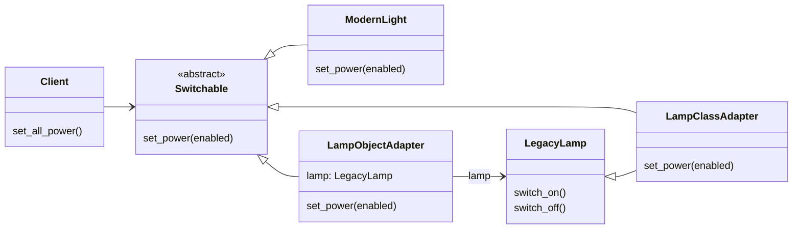
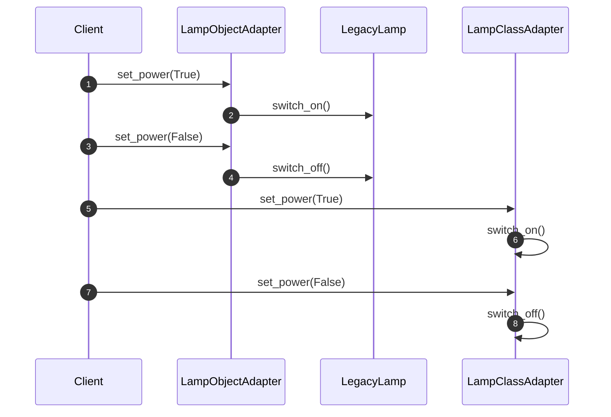

# UML: Adapter

На GitHub блоки Mermaid отображаются как диаграммы. Для просмотра без интернета
откройте [диаграмму классов](classes.svg), [последовательность вызовов](sequence.svg)
или [HTML-шпаргалку](cheatsheet.html).

[Исходники PlantUML](adapter_uml.puml) пригодятся, если вы уже используете эту нотацию.
Для просмотра этих диаграмм дополнительные инструменты не требуются.

## Диаграмма классов

SVG последовательности показывает адаптер объекта; Mermaid ниже сопоставляет оба варианта.

## Последовательность вызовов

SVG — готовые локальные изображения, Mermaid и PlantUML — редактируемые UML-исходники.
При изменении структуры кода обновите соответствующие диаграммы во всех трёх форматах,
затем пересоберите HTML командой `python3 tools/build_cheatsheets.py` из корня проекта.
