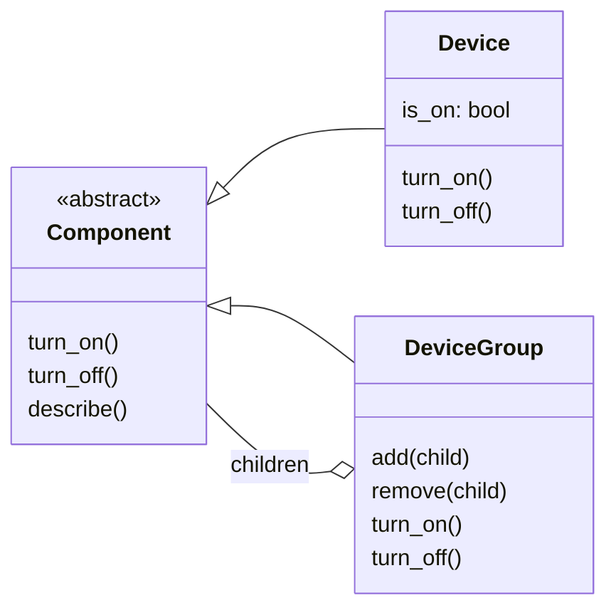
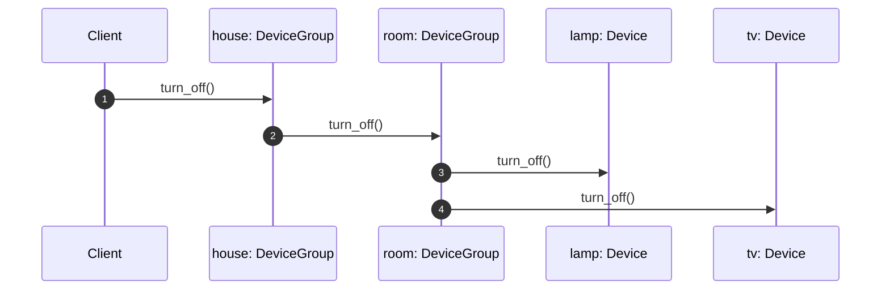

# UML: Composite

На GitHub блоки Mermaid отображаются как диаграммы. Для просмотра без интернета
откройте [диаграмму классов](classes.svg), [последовательность вызовов](sequence.svg)
или [HTML-шпаргалку](cheatsheet.html).

[Исходники PlantUML](composite_uml.puml) пригодятся, если вы уже используете эту нотацию.
Для просмотра этих диаграмм дополнительные инструменты не требуются.

## Диаграмма классов

## Последовательность вызовов

SVG — готовые локальные изображения, Mermaid и PlantUML — редактируемые UML-исходники.
При изменении структуры кода обновите соответствующие диаграммы во всех трёх форматах.
При изменении кода обновите также примеры в HTML-шпаргалке.
